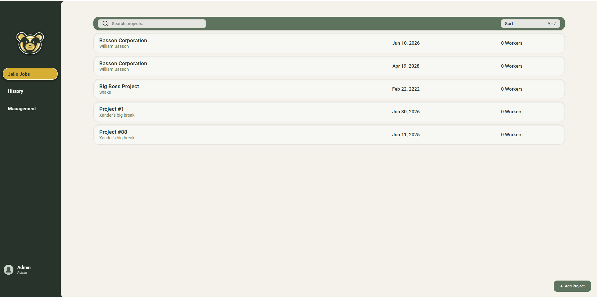
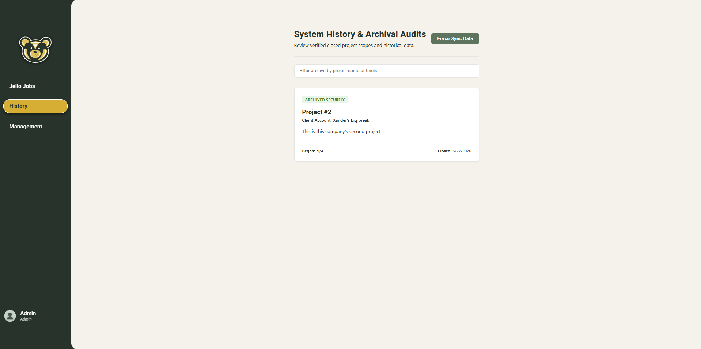
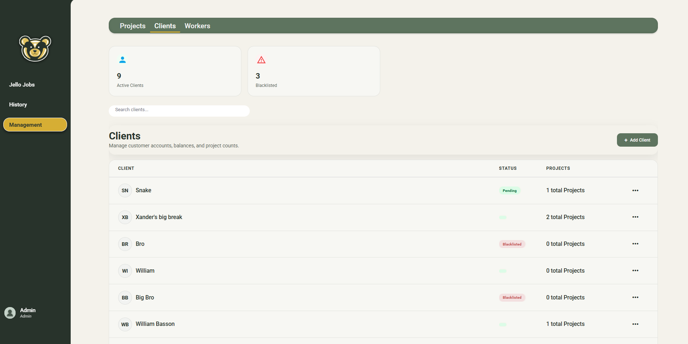
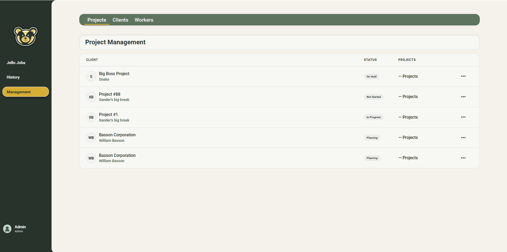
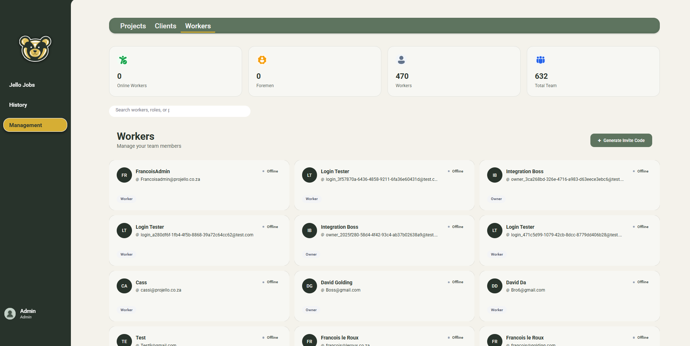
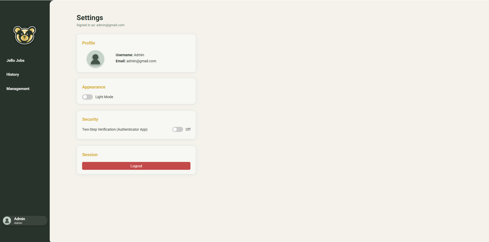
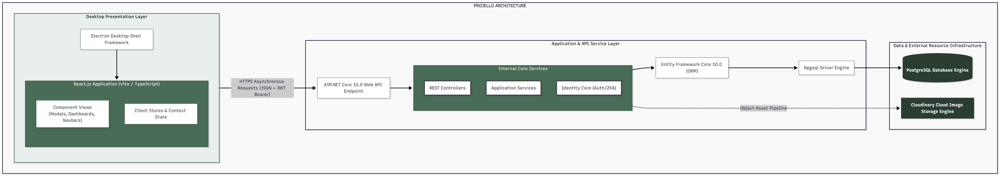

# Projello


> A focused project-management system for construction teams, site crews, and
> clients.

Projello replaces generic, administration-heavy project tools with workflows
that fit construction work: projects are organised into milestones and tasks,
workers can submit quick site updates, managers can track progress, and clients
can see the information relevant to their projects.

This project was developed by Team Cepression for Interactive Development 300
at the Open Window Institute.

## Highlights

- Company, client, project, milestone, and task management
- Role-based access for administrators, foremen, workers, and clients
- JWT authentication with ASP.NET Core Identity
- Two-factor authentication and protected onboarding invitations
- Daily site updates with optional Cloudinary photo uploads
- Dashboard, history, progress, and client-visibility workflows
- Real-time team notifications and project voice/video calls
- Electron desktop application for Windows, macOS, and Linux
- PostgreSQL persistence with Entity Framework Core migrations
- Swagger/OpenAPI documentation for the API
- Light and dark themes designed around Projello's sage-green palette

## Screenshots

| Dashboard | Project history |
| --- | --- |
|  |  |

| Clients | Projects |
| --- | --- |
|  |  |

| Workers | Settings |
| --- | --- |
|  |  |

More interface images are available in [`ReadmeImages/`](ReadmeImages/).

## Architecture



Projello is split into an Electron/React client and an ASP.NET Core API:

```text
Electron + React + TypeScript
              |
       HTTP / SignalR
              |
ASP.NET Core 10 Web API
       |                |
 Entity Framework    SignalR/WebRTC
       |
 PostgreSQL
```

### Technology stack

**Frontend**

- React and TypeScript
- Electron 40
- Electron Forge and Webpack
- SignalR client
- Native WebRTC APIs

**Backend**

- ASP.NET Core 10 and C# 14
- Entity Framework Core 10
- PostgreSQL with Npgsql
- ASP.NET Core Identity and JWT bearer authentication
- Otp.NET for two-factor authentication
- Cloudinary for optional media storage
- SignalR for real-time communication
- Swagger via Swashbuckle

## Repository layout

```text
backend/
  Projello.Api/          ASP.NET Core API, data layer, hubs, and migrations
  Projello.Api.Tests/    Backend unit and integration tests
database/
  docker-compose.yml     Local PostgreSQL and API stack
  .env.example           Local environment-variable template
  seed-demo-data.py      Optional demo-data generator
frontend/
  src/                   React application and Electron renderer
  forge.config.ts        Electron Forge packaging configuration
ReadmeImages/             README screenshots and diagrams
render.yaml               Render deployment definition
Projello-Management-System.sln
```

## Prerequisites

Install the following before developing locally:

- [.NET 10 SDK](https://dotnet.microsoft.com/download/dotnet/10.0)
- [Node.js](https://nodejs.org/) 18 or newer
- [Docker Desktop](https://www.docker.com/products/docker-desktop/)
- Python 3, only if you want to run the demo-data script

## Quick start with Docker

The recommended local setup starts PostgreSQL and the API together. The API
applies Entity Framework migrations on startup.

1. Copy the environment template:

   ```powershell
   Copy-Item database\.env.example database\.env
   ```

2. Edit `database\.env`. At minimum, replace `POSTGRES_PASSWORD` and
   `JWT_KEY`. `JWT_KEY` must be at least 32 bytes.

3. Start the services:

   ```powershell
   docker compose -f database\docker-compose.yml up --build
   ```

The local services are then available at:

- API: <http://localhost:5049>
- Swagger: <http://localhost:5049/swagger>
- Health check: <http://localhost:5049/health>
- PostgreSQL: `localhost:5434`

To stop the stack:

```powershell
docker compose -f database\docker-compose.yml down
```

The database data is stored in the `postgres_data` Docker volume. Add
`--volumes` to the `down` command only when you intentionally want to remove
that data.

### Optional demo data

With the Docker stack running, execute:

```powershell
python database\seed-demo-data.py
```

The script creates sample companies, clients, projects, milestones, and
workers. Demo accounts use the password `Password123!`; do not use these
credentials outside local development.

## Run the desktop client

In a second terminal:

```powershell
cd frontend
npm install
npm start
```

The development client defaults to `http://localhost:5049`. To use another API,
set `API_BASE_URL` when starting or packaging the client:

```powershell
$env:API_BASE_URL = "https://your-api.example.com"
npm start
```

For a production build:

```powershell
npm run package   # Package the application
npm run make      # Create platform installers
```

The API URL is embedded into the frontend build, so rebuild the client after
changing it.

## Run the API directly

Docker is the easiest local setup, but the API can also be run from the .NET
solution. Configure a PostgreSQL connection string and a JWT key using
environment variables or .NET user secrets:

```powershell
cd backend\Projello.Api
dotnet user-secrets set "Jwt:Key" "<random-key-at-least-32-bytes>"
dotnet user-secrets set "ConnectionStrings:DefaultConnection" "<postgres-connection-string>"
dotnet run
```

When running outside Docker, apply migrations separately if required:

```powershell
dotnet ef database update
```

Never commit connection strings, JWT keys, SMTP credentials, Cloudinary
credentials, or TURN credentials.

## Configuration

The Docker setup reads variables from [`database/.env.example`](database/.env.example):

| Variable | Required | Purpose |
| --- | --- | --- |
| `POSTGRES_USER` | Yes | PostgreSQL username |
| `POSTGRES_PASSWORD` | Yes | PostgreSQL password |
| `POSTGRES_DB` | Yes | PostgreSQL database name |
| `JWT_KEY` | Yes | JWT signing key, at least 32 bytes |
| `STUN_URL` | No | ICE/STUN server for calls |
| `TURN_URL` | No | TURN server for restricted networks |
| `TURN_USERNAME` | No | TURN username |
| `TURN_CREDENTIAL` | No | TURN credential |
| `CLOUDINARY_CLOUD_NAME` | No | Cloudinary cloud name |
| `CLOUDINARY_API_KEY` | No | Cloudinary API key |
| `CLOUDINARY_API_SECRET` | No | Cloudinary API secret |

Cloudinary is optional. Without it, photo-upload functionality cannot
successfully store media. A TURN server is recommended for calls between users
on networks that cannot establish a direct WebRTC connection.

## Deployment

### Render API

[`render.yaml`](render.yaml) defines a Docker web service for Render. Create a
Render Blueprint from this repository and provide the secret values when
prompted:

- `ConnectionStrings__DefaultConnection`
- `Jwt__Key`
- SMTP credentials used for password-reset email
- `WebRtc__IceServers__1__Urls__0`
- `WebRtc__IceServers__1__Username`
- `WebRtc__IceServers__1__Credential`

The service exposes `/health` for health checks. After deployment, build the
Electron client with the deployed API URL:

```powershell
cd frontend
$env:API_BASE_URL = "https://your-api.onrender.com"
npm run make
```

Configure the exact frontend origin in `Cors__AllowedOrigins__0` when the
frontend is hosted separately.

### LAN demonstration

To build a desktop client that connects to an API on another computer on the
same network:

```powershell
cd frontend
$env:API_BASE_URL = "http://<api-computer-ip>:5049"
npm run make
```

Allow port `5049` through the API computer's firewall. This is suitable for a
local demonstration, not production deployment.

## Testing and linting

Run the backend test suite from the repository root:

```powershell
dotnet test Projello-Management-System.sln
```

Run frontend tests and linting:

```powershell
cd frontend
npm test -- --runInBand
npm run lint
```

## Security notes

- The API refuses to start when `Jwt:Key` is missing or shorter than 32 bytes.
- Login and two-factor endpoints are rate-limited.
- Failed authentication attempts use Identity lockout rules.
- SignalR hubs require authenticated connections.
- CORS allows configured origins plus local Electron/development origins.
- Use separate secrets for development, staging, and production.
- Calls use WebRTC; use TURN when direct peer connections are not reliable.

## Project documentation

- [Entity relationship diagram](ReadmeImages/ERD.png)
- [Architecture diagram](ReadmeImages/Architecture.png)
- [Backend project](backend/Projello.Api/)
- [Frontend project](frontend/)

## Contributors

Developed by Team Cepression:

- Angie van Rooyen
- Xander Poalses
- David Golding
- Francois le Roux

**Client / stakeholder:** William Basson
**Institution:** Open Window Institute  
**Module:** Interactive Development 300  
**Year:** 2026
