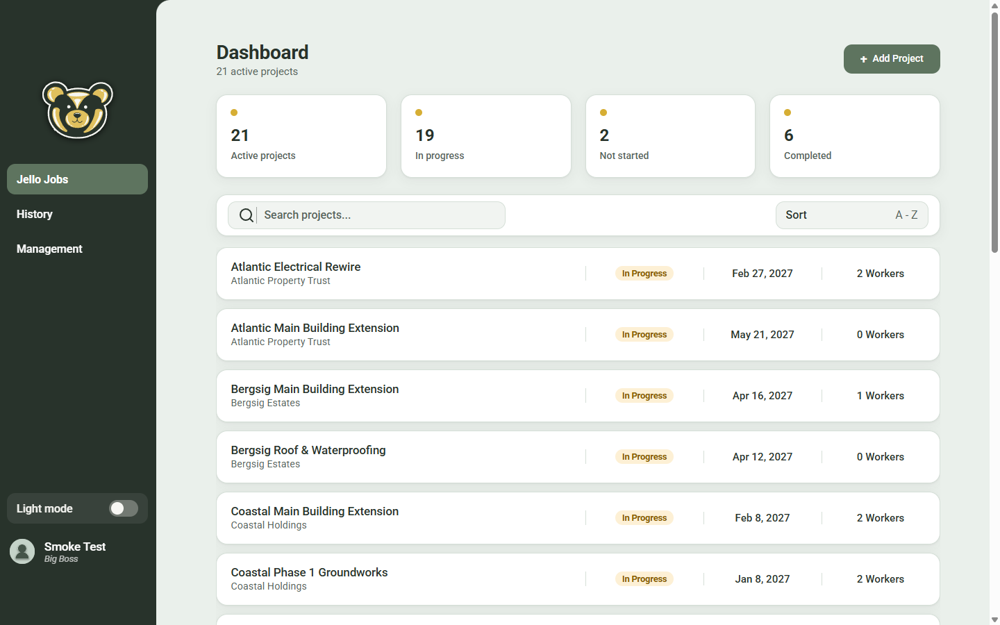
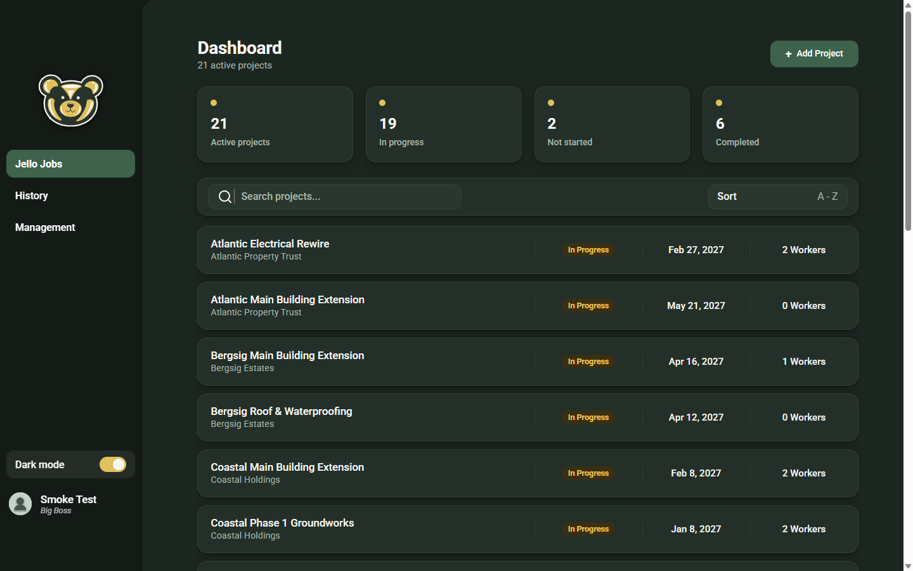
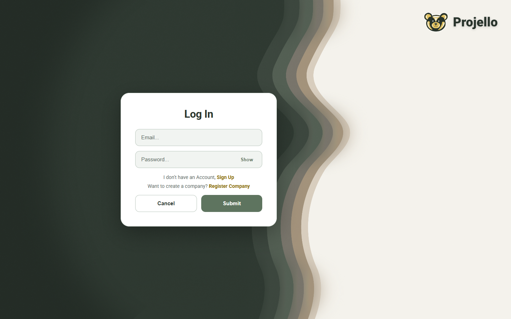
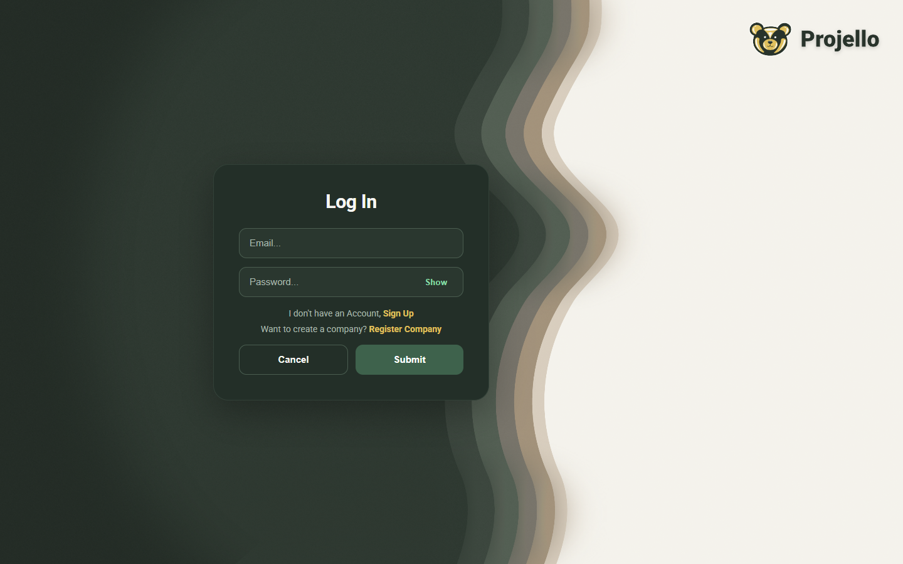
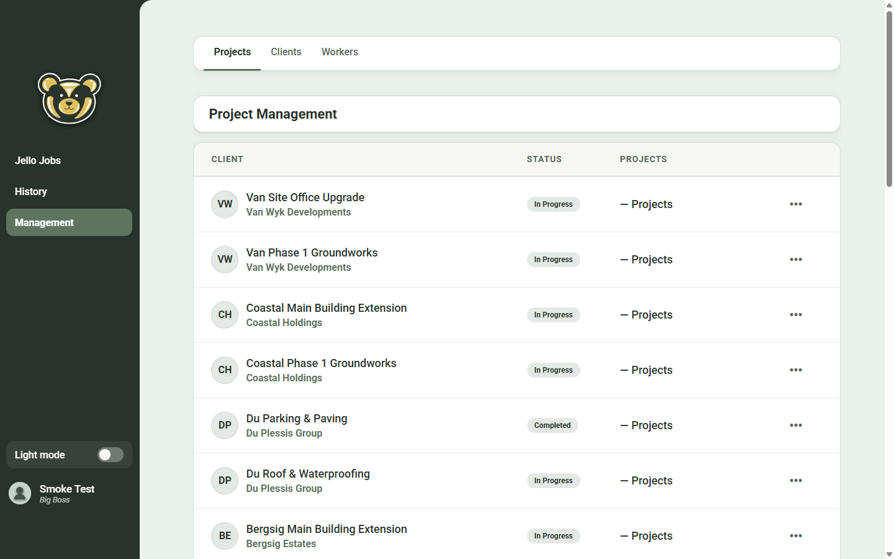
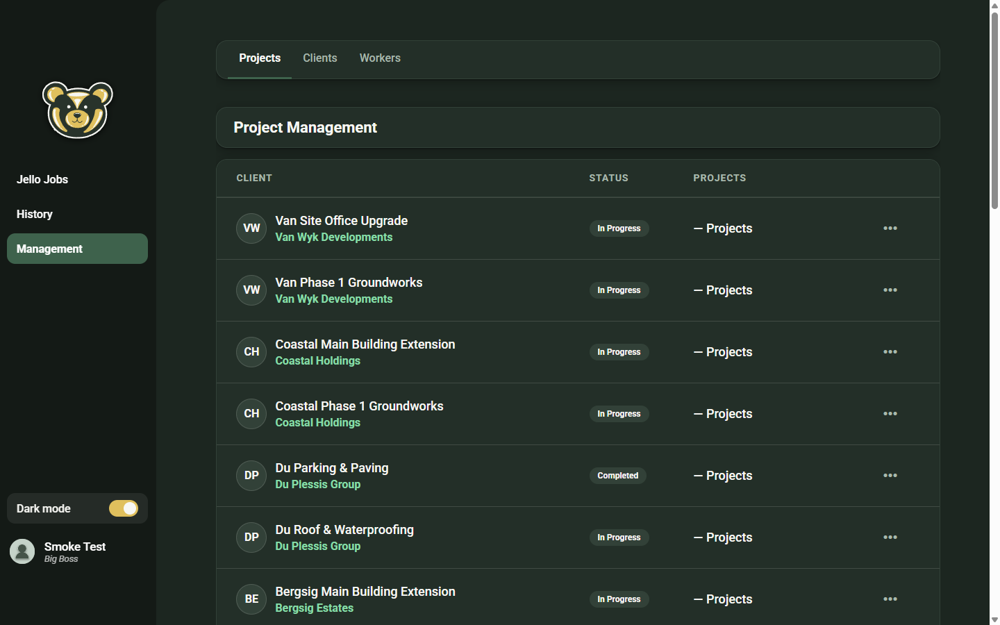

<!--
Copy everything below the line into README.md (screenshots are in docs/screenshots/).
This file is a scratch document and is not meant to be committed.
-->

---

## What I changed in this fork

I took the original Projello project (ASP.NET Core API + React/Electron app) and worked on three areas: security, the interface, and getting the whole stack to run with one command.

### Security hardening (backend)

| Area | Before | Now |
|---|---|---|
| JWT signing key | Committed in `appsettings.json` with a hard-coded fallback | Removed. The API refuses to start unless `Jwt:Key` is set and at least 32 bytes (user-secrets locally, `Jwt__Key` in production) |
| Login attempts | Unlimited | Account locks for 15 minutes after 5 failed attempts (passwords and 2FA codes) |
| Brute force on auth endpoints | None | Rate limit of 10 requests per minute per IP on register, login and 2FA endpoints (configurable) |
| `2fa-status` endpoint | Public, accepted any email | Requires login and only answers for the caller |
| Client list | Visible to workers | Only Admin, Foreman and Owner roles; workers only see the projects they are assigned to |
| Call hub (SignalR) | No authentication | `[Authorize]` required |

New tests cover lockout and rate limiting. The backend suite is **158 passing tests**, and the frontend suite is **21 passing tests**. Both were repaired as part of this work: the backend integration tests now use an in-memory database instead of needing a real Postgres.

### Interface

- A working **light/dark theme switch** that remembers the choice and falls back to the operating system setting.
- All colours now come from **CSS design tokens** (`frontend/src/index.css`) instead of values hard-coded per component.
- A card-based layout with better spacing and contrast across the dashboard, management, history, settings, project and login screens. The brand colours, icons and fonts are unchanged.
- A clickable logo on the login screen that skipped authentication was removed.

| Light | Dark |
|---|---|
|  |  |
|  |  |
|  |  |

### One-command local stack

`database/docker-compose.yml` now starts both the PostgreSQL database and the API (migrations run on startup).

```bash
cd database
cp .env.example .env     # then set POSTGRES_PASSWORD and a JWT_KEY of 32+ characters
docker compose up -d     # API on http://localhost:5049, database on port 5434
```

`database/seed-demo-data.py` fills the database with three demo companies, clients, projects, milestones and workers.

### Voice and video calls

Project members can ring each other from a project page (WebRTC for media, SignalR for signalling, STUN server configured through the API). I tested the flow with an automated script that signs in two different users in separate browser sessions, with a simulated microphone and camera. One user rang the other, who accepted, and both sides showed a connected call with video. I ran this against the development build and the packaged Windows app on a single machine. I have **not** tested it across two physical computers or with real hardware.

### Building a Windows installer for a LAN demo

The packaged app talks to the hosted API by default. To point it at a laptop on the same network:

```powershell
cd frontend
$env:API_BASE_URL = "http://<laptop-ip>:5049"
npm run make
```

The address is baked into the build, so it must be rebuilt if the laptop's IP changes. Port 5049 must be allowed through the firewall.

### Known limitations

- Photo uploads and the "site updates" panel need Cloudinary credentials (`CLOUDINARY_*` in `database/.env`); without them that panel shows an error.
- Calls between different networks would need a TURN server; only a public STUN server is configured.
- Refresh tokens were not added.
- The Windows installer step needs `7z.exe` next to `7z-x64.exe` inside `node_modules/electron-winstaller/vendor` with the current dependency versions.
